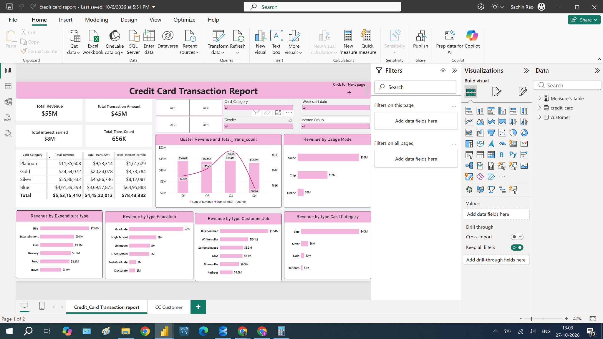
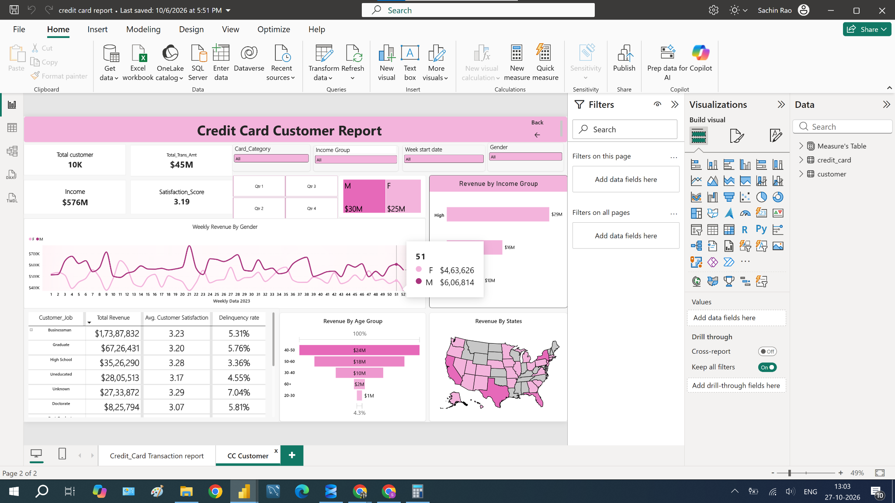

# Credit Card Analysis | Power BI

I built this report to understand how credit card activity differs across card categories, spending patterns and customer groups. I wanted to bring the main financial and customer measures into one place, with enough detail to explore what contributes to the overall numbers.

I organised the report into two pages: a **Credit Card Transaction Report** for card performance and a **Credit Card Customer Report** for customer behaviour. Together, they cover **10,108 customers**, **655,651 aggregated transactions** and **$55.32 million in revenue under the calculation used in this report**. The reporting dates run from **1 January to 24 December 2023**.

[Open the Power BI file](Report/Credit_Card_Report.pbix)

## What I wanted to find out

- Which card categories contribute the most revenue?
- How do revenue and transaction volume change across quarters?
- Which usage modes and expenditure categories contribute the most?
- How does revenue differ by occupation, education, income and age?
- How do satisfaction and delinquency compare across customer segments?
- How is revenue distributed across US states?

## Dashboard preview

### Credit Card Transaction Report



I used this page to summarise revenue, transaction amount, transaction volume and interest earned. The quarterly chart compares revenue with transaction volume, while the category charts break revenue down by card type, usage mode, expenditure, education and occupation.

### Credit Card Customer Report



I used this page to explore customer count, income, satisfaction and delinquency alongside revenue. It includes a weekly revenue trend by gender, age and income comparisons, a customer-segment matrix and a US state map.

Both pages include slicers for card category, gender, income group, reporting date and quarter. Navigation buttons let users move between the two pages.

## Data and preparation

I worked with two CSV inputs:

| Table | What it contains |
|---|---|
| `credit_card` | Card category, fees, transaction amount and volume, interest, usage mode, expenditure type, reporting dates and delinquency flag |
| `customer` | Age, gender, education, occupation, income, state and customer satisfaction |

Each table has **one row per client** in this dataset. I connected them through `Client_Num` using an active **one-to-one relationship with filtering in both directions**. Transaction volume is already aggregated in the source: 655,651 is the sum of that field, not the number of transaction rows in the model.

In Power Query, I promoted headers, assigned data types and corrected the reporting-date text by splitting and reassembling its parts before converting it to a date. I then created age and income groups in DAX to make customer comparisons easier to read.

## Calculations used

The main measures and calculated columns cover:

- Revenue and distinct customer count.
- Age groups and income groups.
- Current, previous and next week revenue.
- Week-over-week percentage change.
- Customer delinquency rate.

### Revenue

```dax
Revenue =
credit_card[Annual_Fees]
    + credit_card[Total_Trans_Amt]
    + credit_card[Interest_Earned]
```

This is the revenue definition used throughout the report. It combines fees, transaction amount and interest; it does not represent bank profit.

### Customer count

```dax
Total customer =
DISTINCTCOUNT(customer[Client_Num])
```

### Customer segmentation

I grouped income into **Low** (below 35,000), **Med** (35,000 to below 70,000) and **High** (70,000 and above). Age bands support comparisons across customers under 30, 30–39, 40–49, 50–59 and 60+.

The full expressions are available in [DAX measures](DAX/Measures.dax) and [calculated columns](DAX/Calculated_Columns.dax). The weekly line chart plots revenue by week and gender; the separate weekly comparison measures are also available in the model.

## Overall results

These figures represent the full dataset without slicer selections.

| Metric | Result |
|---|---:|
| Revenue | $55,315,410.23 |
| Transaction amount | $44,522,013 |
| Transaction volume | 655,651 |
| Interest earned | $7,843,382.23 |
| Customers | 10,108 |
| Average satisfaction score | 3.19 |
| Delinquent customers | 614 |
| Customer delinquency rate | 6.07% |

## Insights I found

### Blue cards account for most of the revenue

Blue cards contribute **$46.14 million**, or approximately **83.41% of total revenue**. Silver contributes $5.59 million, followed by Gold at $2.45 million and Platinum at $1.14 million. This shows how concentrated the overall contribution is in the Blue category.

### Swipe leads the usage-mode comparison

Swipe contributes **$34.91 million**, compared with **$16.97 million for Chip** and **$3.44 million for Online**. It is the largest contributor among the three recorded usage modes.

### Bills are the leading expenditure category

Bills contribute **$13.78 million**. Entertainment follows at **$9.52 million**, with Fuel at **$9.33 million**. These comparisons help show which spending categories contribute most to the total.

### Q3 records the highest quarterly revenue

Revenue reaches **$14.24 million in Q3**, compared with **$13.30 million in Q4**. The quarterly chart lets me compare that pattern with transaction volume rather than looking at revenue alone.

### Income and age reveal distinct customer contributions

The **High-income group contributes $29.23 million**, the largest income-group total. Customers aged **40 to under 50 contribute $24.28 million**, followed by those aged 50 to under 60 at $18.19 million.

### Occupation adds another useful view

The **Businessman** group contributes **$17.39 million**, the highest occupation total. The customer matrix lets users examine revenue alongside satisfaction and delinquency within occupation and education groups.

These are comparisons of total contribution. A larger total does not automatically mean higher revenue per customer or lower risk; those would need their own calculations.

## Skills I practised

This project helped me practise connecting related tables, preparing dates, building DAX calculations and choosing visuals for different business questions. I also worked on combining summary KPIs with filters and detailed breakdowns, so users can move from an overall result to a specific customer or card segment.

**Tools:** Power BI Desktop, Power Query and DAX.

## Explore the report

